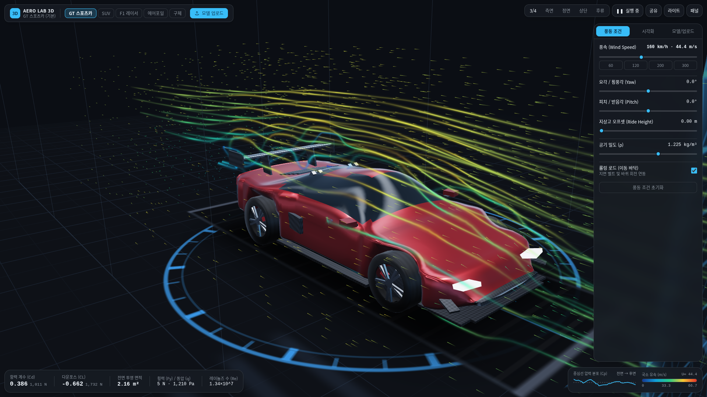
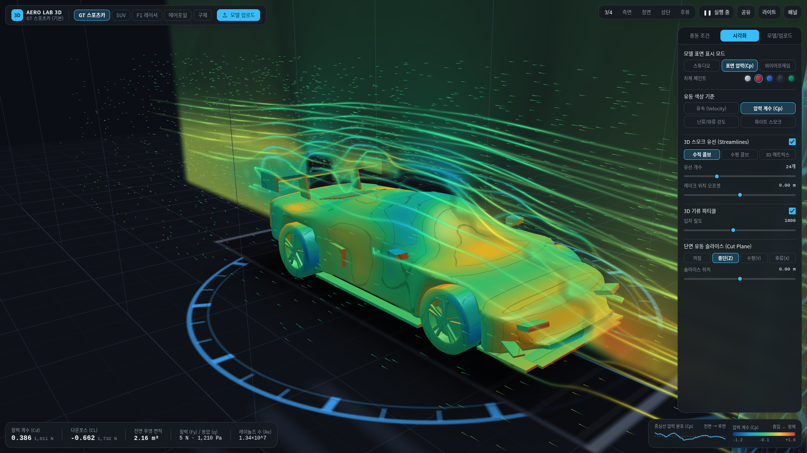
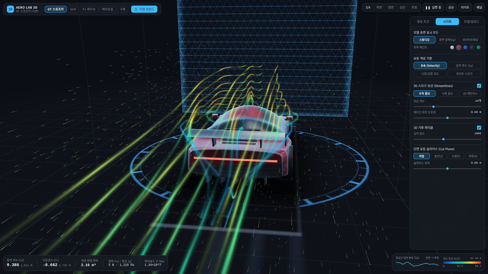
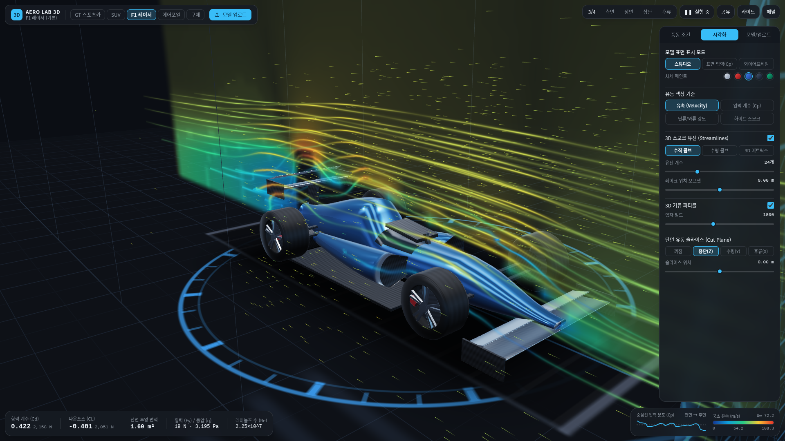
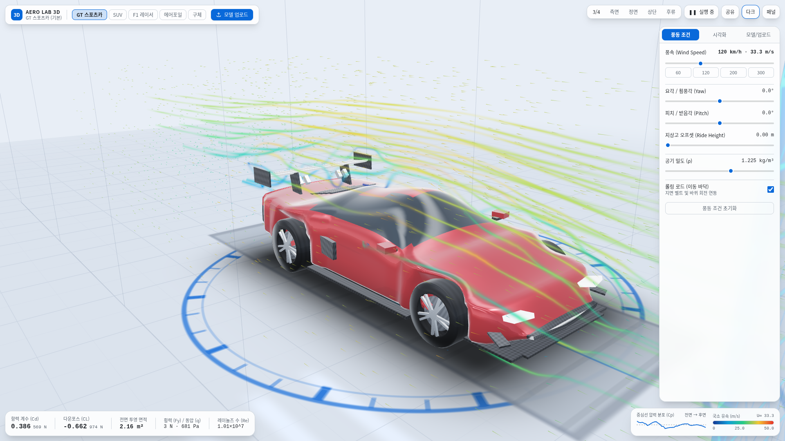

# AERO LAB 3D — 3D 풍동 실험 시뮬레이션

별도 백엔드 서버 없이 브라우저의 WebGL2와 클라이언트 측 3D CFD 솔버로 동작하는 **고동시성 정적 3D 풍동 시뮬레이션**입니다.

## 주요 기능

- **기본 자동차 & 비교 프리셋 모델**: GT 스포츠카(기본), SUV, F1 레이서, NACA 2412 에어포일, 표준 구체
- **사용자 3D 모델 업로드**: `.glb`, `.gltf`, `.obj`, `.stl` (Binary/ASCII, 최대 50MB 안전 가드), 자동 정규화 및 축 방향 보정
- **고디테일 GGX 클리어코트 PBR 그래픽**: 천장 LED 소프트박스 스튜디오 반사(IBL), 5종 차체 페인트 선택, 2×2 트윌 카본 직조 질감, 10스포크 단조 휠·브레이크 로터·고정형 크림슨 캘리퍼, 백라이트 허니콤 풍동 입구, 광택 에폭시 반사 바닥
- **실시간 3D 복셀 CFD 해석**: 항력 계수($C_d$), 항력($F_D$), 다운포스/양력($C_L, F_L$), 횡력($F_Y$), 전면 투영 면적($A$), 동압($q$), 레이놀즈 수($Re$), 중심선 $C_p$ 분포 그래프
- **3D 풍동 시각화**: 3D 볼류메트릭 스모크 유선, 기류 파티클, 모델 표면 압력($C_p$) 등압선 히트맵, 이동식 2D 단면 슬라이스, 롤링 로드 및 요각 턴테이블
- **다중 동시 접속 최적화**: 100% 클라이언트 독립 실행, 외부 CDN 의존성 제거([styles.css](./styles.css)), Vercel Edge CDN 캐싱([vercel.json](./vercel.json)), GPU 버퍼 해제, WebGL 컨텍스트 자동 복구, 실험 조건 URL 공유(`공유` 버튼)

## 스크린샷 갤러리 (`screenshots/`)

| 화면 | 미리보기 |
| --- | --- |
| **GT 스포츠카 스튜디오 (Full HD)** |  |
| **표면 압력(Cp) 히트맵 + 2D 단면 슬라이스** |  |
| **후면 와류(Wake) & 허니콤 풍동 입구** |  |
| **F1 레이서 고속(260 km/h) 유동 해석** |  |
| **사용자 3D 모델(.glb/.obj/.stl) 업로드** |  |
| **라이트 스튜디오 테마** |  |

## Vercel 배포 방법

1. [Vercel Import 페이지](https://vercel.com/new/import?s=https%3A%2F%2Fgithub.com%2Fknoxxr%2Fwind-tunnel-3d)에서 `knoxxr/wind-tunnel-3d` 저장소를 선택하고 **Deploy**를 클릭합니다.
2. 이후 `main` 브랜치에 푸시할 때마다 Vercel이 자동으로 재배포합니다.
