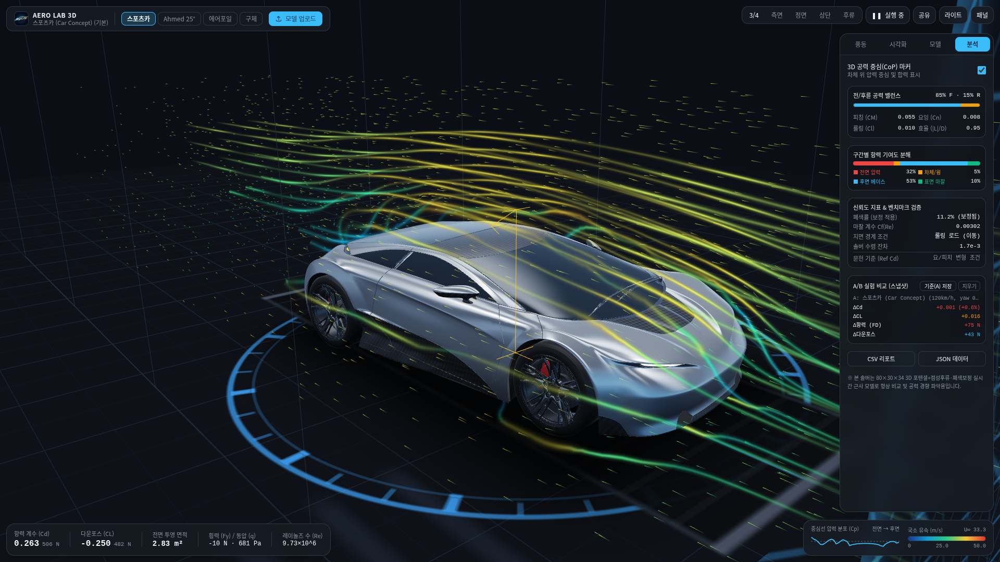
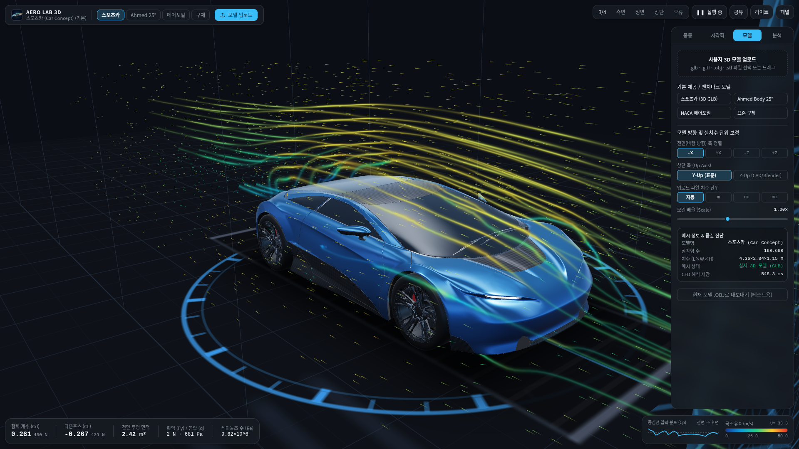

# AERO LAB 3D — 3D 풍동 실험 시뮬레이션

별도 백엔드 서버 없이 브라우저의 WebGL2와 클라이언트 측 3D CFD 솔버로 동작하는 **고동시성 정적 3D 풍동 시뮬레이션**입니다.

## 주요 기능

- **실사 무료 3D 자동차 모델 (단일 차량) & 공력 벤치마크**: 오픈소스 **Car Concept (168,668 삼각형 실사 3D GLB)** 기본 탑재 + 공력 검증용 비차량 기준 모델(**Ahmed Body 25°**, NACA 2412 에어포일, 표준 구체)
- **사용자 3D 모델 업로드 & 메시 자동 보정**: `.glb`, `.gltf`, `.obj`, `.stl` (Binary/ASCII, 최대 50MB 안전 가드), glTF 재질 자동 PBR 분류, 실제 CAD 단위(`자동`/`m`/`cm`/`mm`) 지원, 반전된 법선/와인딩 자동 감지·복구
- **고디테일 GGX 클리어코트 PBR 그래픽**: 천장 LED 소프트박스 스튜디오 반사(IBL), 5종 차체 페인트 실시간 전환, 2×2 트윌 카본 직조 질감, 멀티스포크 휠·브레이크 로터·크림슨 캘리퍼, 백라이트 허니콤 풍동 입구, 광택 에폭시 반사 바닥
- **고신뢰도 80×30×34 3D CFD 해석 & 공학 분석 탭**:
  - 롤링 로드(이동 바닥) vs 고정 바닥 1/7승 경계층 물리 분리
  - 레이놀즈 수($Re$) 종속 피부 마찰 계수 $C_f(Re)$ (Prandtl–Schlichting / Blasius 블렌딩)
  - 풍동 폐색률($\beta$) 측정 및 Maskell/Mercker 자유유동 보정, 요각 횡풍 와류 항력 모델
  - **6분력 모멘트($C_M, C_n, C_l$)**, 전/후륜 공력 밸런스, **3D 공력 중심(CoP) 마커**, 4구간 항력 기여도 분해
  - **A/B 실험 비교 스냅샷** ($\Delta C_d, \Delta C_L, \Delta F_D, \Delta\text{다운포스}$) 및 **CSV / JSON 공학 리포트 내보내기**
- **3D 풍동 시각화**: 3D 볼류메트릭 스모크 유선, 기류 파티클, 모델 표면 압력($C_p$) 등압선 히트맵, 이동식 2D 단면 슬라이스, 3D CoP 합력 마커
- **다중 동시 접속 최적화**: 100% 클라이언트 독립 실행, 외부 CDN 의존성 제거([styles.css](./styles.css)), Vercel Edge CDN 캐싱([vercel.json](./vercel.json)), GPU 버퍼 해제, WebGL 컨텍스트 자동 복구, 실험 조건 URL 공유(`공유` 버튼)

## 3D 모델 출처 및 라이선스

- **기본 자동차 모델 (`models/car_concept.glb`)**: [Khronos Group glTF-Sample-Assets — Car Concept](https://github.com/KhronosGroup/glTF-Sample-Assets/tree/main/Models/CarConcept) (CC-BY-4.0: Darmstadt Graphics Group GmbH & Eric Chadwick, 원작 Sketchfab Unity Fan CC0) 외장 최적화 버전.

## 스크린샷 갤러리 (`screenshots/`)

| 화면 | 미리보기 |
| --- | --- |
| **실사 3D 스포츠카 스튜디오 (Full HD)** |  |
| **표면 압력(Cp) 히트맵 + 2D 단면 슬라이스** |  |
| **후면 와류(Wake) & 허니콤 풍동 입구** |  |
| **공학 분석 탭 (3D CoP 마커 · 6분력 · A/B 비교)** |  |
| **사용자 3D 모델(.glb/.obj/.stl) 업로드 & CAD 단위** |  |
| **라이트 스튜디오 테마** |  |

## Vercel 배포 방법

1. [Vercel Import 페이지](https://vercel.com/new/import?s=https%3A%2F%2Fgithub.com%2Fknoxxr%2Fwind-tunnel-3d)에서 `knoxxr/wind-tunnel-3d` 저장소를 선택하고 **Deploy**를 클릭합니다.
2. 이후 `main` 브랜치에 푸시할 때마다 Vercel이 자동으로 재배포합니다.
